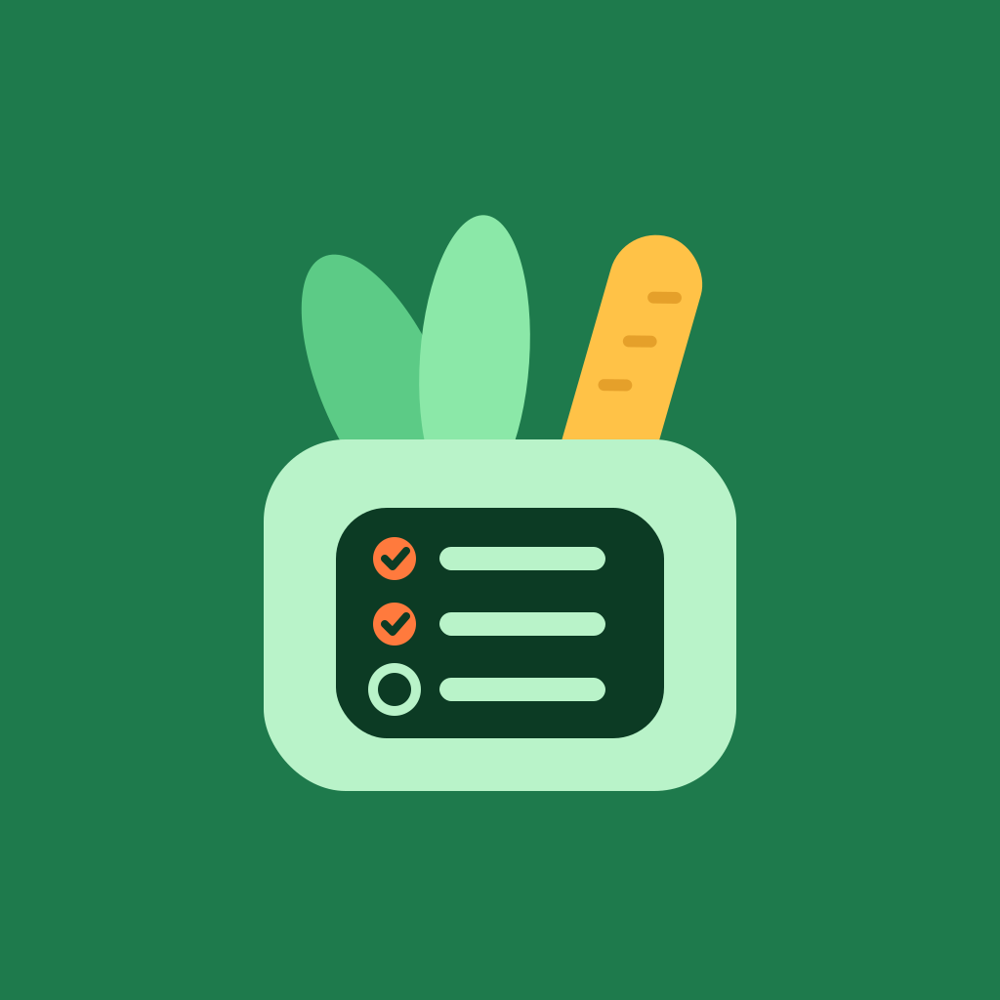

<p align="center">
  
</p>

<h1 align="center">PrepList</h1>

<p align="center">
  Plan meals, organize recipes, track nutrition, and manage groceries and food inventory, all in one app.
</p>

<p align="center">
  
  
  
</p>

> **Alpha release.** PrepList is in early development. Features may be incomplete and unexpected issues may occur. Keep backups of important data while testing.

## Features

| Tab | What it does |
| --- | --- |
| **Plan** | Organize your meals throughout the week. |
| **Recipes** | Create recipes and manage their ingredients. |
| **Groceries** | Keep track of your shopping list. |
| **Inventory** | Manage the food items you have on hand, with usage history and undo. |

### Food database

- **Your choice on first launch:** import the [Swiss Food Composition Database](https://www.naehrwertdaten.ch) for thousands of foods, or start without it.
- **Your own foods:** create foods with custom calories, protein, carbohydrates and fat per 100 g, with or without the Swiss database. Create them from the food picker while adding an ingredient or meal, or manage them under **My foods** in the menu.
- **Import later:** if you skipped the download, you can import (or update) the Swiss database any time from **My foods**.
- Calories and macros are calculated automatically for recipes and meals from the foods you pick.

### Interface

- Material 3 design with dynamic color (Material You) on supported devices
- Adaptive layout: bottom navigation bar on phones, navigation rail on tablets and in landscape, with content width limited on large screens
- Dialogs and lists resize to fit small screens and the keyboard
- Messages appear at the top of the screen, above dialogs and navigation

## Privacy

Recipes, meal plans, groceries, inventory and your custom foods are stored in an SQLite database on your device. The app only connects to the internet if you choose to import the Swiss food database.

## Getting started

### Requirements

- [Flutter SDK](https://docs.flutter.dev/get-started/install) (Dart `^3.13.7`)
- Android Studio or VS Code with the Flutter extension
- An Android device or emulator (or a Mac with Xcode for iOS)

### Run

```bash
git clone https://github.com/PalamarchukOleksii/PrepList.git
cd PrepList
flutter pub get
flutter run
```

## Project structure

```
lib/
├── main.dart                   # App entry, theme, dynamic color
├── app/                        # App shell: main screen, About, startup flow
│   └── widgets/                # Shared widgets (app logo)
├── core/
│   ├── constants/              # Measurement units
│   ├── database/               # SQLite setup and migrations
│   └── ui/                     # Top messages, responsive helpers
├── data/
│   ├── api/                    # Swiss food API client
│   └── services/               # Swiss database import
└── features/
    ├── foods/                  # Food model, repository, picker, editor, My foods
    ├── meal_planning/          # Week plan
    ├── recipes/                # Recipes and ingredients
    ├── groceries/              # Shopping list
    ├── inventory/              # Food inventory
    └── nutrition/              # Calorie and macro calculations
assets/
└── icon/                       # App icon sources (PNG)
```

## Database

The database (`preplist.db`) is migrated automatically on app start. Imported Swiss foods and custom foods share one `foods` table and are told apart by a `source` column. Custom foods use negative IDs so they never collide with Swiss IDs, and re-importing the Swiss database never removes them.

## Tech stack

- [Flutter](https://flutter.dev) with Material 3
- [`sqflite`](https://pub.dev/packages/sqflite) for local storage
- [`dynamic_color`](https://pub.dev/packages/dynamic_color) for Material You theming
- [`http`](https://pub.dev/packages/http) for the optional food data import
- [`package_info_plus`](https://pub.dev/packages/package_info_plus) for version info
- [`path`](https://pub.dev/packages/path)

## App icon

The launcher icons are generated with [`flutter_launcher_icons`](https://pub.dev/packages/flutter_launcher_icons) from the PNGs in `assets/icon/`. After changing them, regenerate:

```bash
dart run flutter_launcher_icons
```

## Building

### Android

Make sure `android/app/src/main/AndroidManifest.xml` contains (needed for the optional import in release builds):

```xml
<uses-permission android:name="android.permission.INTERNET"/>
```

Then build:

```bash
# Smaller APKs, one per CPU type (arm64-v8a works for most phones)
flutter build apk --release --split-per-abi

# Single APK for any device
flutter build apk --release

# App bundle for Google Play (requires a release keystore)
flutter build appbundle --release
```

Output is in `build/app/outputs/`.

For personal use, the release APK is signed with the debug key unless you configure `android/key.properties`. Updates only install over an existing copy if both were signed with the same key. For publishing, set up a proper keystore and keep it backed up.

### iOS

Requires a Mac with Xcode and an Apple Developer team configured in `ios/Runner.xcworkspace`:

```bash
flutter build ipa --release
```

## Contributing

Issues and pull requests are welcome. Please open an issue first to discuss larger changes.

## License

Released under the [MIT License](LICENSE).

Copyright © 2026 Oleksii Palamarchuk